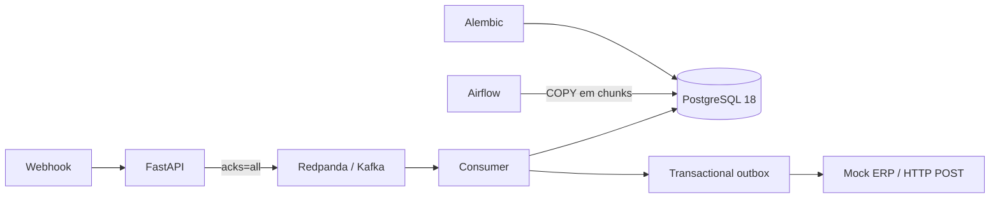

# Plataforma de dados de e-commerce

Ambiente de desenvolvimento com Apache Airflow 3.3.2/Python 3.14, PostgreSQL 18, FastAPI, Alembic e Redpanda (API Kafka). A plataforma conserva o Compose e a DAG Airflow existentes e acrescenta ingestão assíncrona, persistência idempotente e entrega de eventos a um ERP fictício.

> **Segurança:** não versione `.env`, credenciais, kubeconfig, logs, dados, tokens ou imagens. As credenciais de desenvolvimento foram compartilhadas nesta conversa; rotacione-as antes de usar qualquer serviço fora da máquina local. `.env.example` contém apenas valores de exemplo.

## Arquitetura



### Por que Kafka (Abordagem B)

A API valida e publica o evento no Redpanda com confirmação de todas as réplicas (`acks=all`) e producer idempotente; o webhook recebe `202` depois da confirmação do broker. O consumidor persiste em transação e só confirma o offset depois do commit. A chave Kafka é o ID do pedido, preservando a ordem por pedido. O broker desacopla picos de milhares de requisições/s do banco, mantendo eventos em disco para consumo posterior. O Compose usa um nó em modo desenvolvimento; para produção, usar cluster distribuído, partições dimensionadas, TLS/SASL, retenção/replicação apropriadas, quotas e métricas.

O banco tem pool limitado (10 conexões + até 5 overflow, timeout de 10 s); não se abre conexão por webhook na API. A tabela `processed_events` e o identificador do pedido aplicam idempotência no consumidor. Invoice e outbox têm unicidade por pedido, prevenindo duplicação mesmo após reentrega/restart. A transação de persistência é atômica.

### Dados, histórico e imutabilidade

O esquema `ecommerce` contém `clients`, `address` (versões imutáveis por cliente/endereço), `orders`, `order_items`, `payment`, `invoices`, `processed_events`, `order_event_history` e `outbox_events`. FKs usam `RESTRICT`; snapshots JSONB guardam cliente/endereço/itens como eram no pedido. Alterações cadastrais geram uma nova versão de endereço, e mudanças de status são registradas no histórico. Trigger PostgreSQL impede atualização/remoção de pedido fechado. Um pedido pendente pode avançar para estado terminal; depois de fechado, os snapshots/valores não podem ser alterados.

### Observação sobre SQL Server

A missão original pede especificamente SQL Server e técnicas Python↔SQL Server. O Compose existente não tinha SQL Server e foi mantido PostgreSQL, conforme a decisão desta implementação. A DAG de 10 milhões usa `COPY` (bulk load nativo do PostgreSQL), em chunks limitados e com IDs determinísticos por execução. Isso atende à escala/memória e velocidade no stack atual, mas **não comprova** a exigência literal SQL Server/ODBC/`fast_executemany`. Para avaliação estrita, adicionar SQL Server e trocar a DAG para `pyodbc` + ODBC Driver 18 (`fast_executemany` ou `BULK INSERT`) antes de considerar esse requisito concluído.

## Requisitos

- Docker Desktop com Docker Compose v2 (Linux containers/WSL2 no Windows).
- Pelo menos 6 GB RAM para Airflow, PostgreSQL e broker local; recomendado 8 GB.
- Para o cluster Kubernetes opcional: `kind` e `kubectl`.

## Configuração e execução

1. Copie `.env.example` para `.env`, substitua todos os valores por segredos fortes e mantenha o arquivo fora do Git. Gere a chave Fernet conforme a documentação oficial do Airflow.
2. Inicie a stack (inclui build da imagem FastAPI; Airflow pode ser construído se necessário):

```powershell
Copy-Item .env.example .env
# Edite .env antes de iniciar
 docker compose up -d --build
 docker compose ps
```

A migration Alembic roda automaticamente após PostgreSQL ficar saudável. Endpoints locais:

- Airflow: http://localhost:8080
- FastAPI: http://localhost:8000/docs
- Health API: http://localhost:8000/health
- PostgreSQL: `localhost:5432`
- Redpanda Kafka: `localhost:19092` (uso local; comunicação Compose usa `redpanda:9092`)

O init cria o usuário FAB, porém o auth manager padrão Simple do Airflow 3 pode emitir senha temporária aleatória no primeiro startup, em vez de usar esse usuário. Confira os logs `airflow-apiserver` e configure um auth manager real para ambientes além do desenvolvimento. O mock ERP fica apenas na rede interna do Compose. Para logs: `docker compose logs -f backend-api ecommerce-worker`.

Para parar: `docker compose down`. `docker compose down -v` também apaga os dados do PostgreSQL/Redpanda e é destrutivo.

## API de webhooks

`POST /webhooks/orders` recebe JSON com `event_id`, `order_id` UUID, `occurred_at`, `client`, `address`, `items`, `currency`, `status` e `payment`. Envie `Idempotency-Key` igual ao `event_id`. O payload é limitado a 256 KiB; os itens a 100 por pedido. Status suportados incluem `PENDING` e `APPROVED`; pagamento `PENDING`, `APPROVED` ou `DECLINED`. Valor pago precisa ser igual à soma dos itens. Resposta `202` confirma apenas que o evento foi persistido pelo broker, não que já foi gravado no PostgreSQL.

Após um pedido aprovado e pago, o worker registra uma invoice e, na mesma transação, uma linha na outbox. A entrega HTTP usa retry exponencial persistido e `Idempotency-Key` baseado no ID do pedido. O consumidor externo real deve deduplicar essa chave duravelmente; o mock atual é demonstrativo e mantém estado apenas em memória. Garantia externa é *at-least-once*, não exactly-once através da rede.

## Migrações

```powershell
docker compose run --rm backend-migrate
```

Migrações ficam em `backend/alembic/versions`. Não altere migration já aplicada; crie uma nova revision para mudanças posteriores.

## DAG de 10 milhões

A DAG `ecommerce_bulk_load_10m` gera 10.000.000 linhas por execução manual. Usa `COPY` para uma tabela temporária em blocos de 25.000 registros e depois insere com `ON CONFLICT DO NOTHING`. A geração é streaming/bounded-memory; cada chunk faz commit, e IDs determinísticos tornam retries idempotentes. Ela não carrega os 10 milhões em XCom/memória. Inicie manualmente pela UI Airflow; `BULK_ROWS` e `BULK_CHUNK_SIZE` do `.env` permitem configurar execução menor para teste.

## Cluster Kubernetes opcional

```powershell
kind create cluster --name airflow-k8s135 --image kindest/node:v1.35.0 --config k8s/kind-config.yaml
kubectl cluster-info --context kind-airflow-k8s135
```

Este cluster não está conectado ao executor Airflow: a stack mantém `LocalExecutor`.

## Branches por etapa

O trabalho deve ser separado em branches sequenciais: `stage/1-data-migrations`, `stage/2-kafka-ingestion`, `stage/3-airflow-bulk-load` e `stage/4-event-delivery`. Cada etapa parte da etapa anterior e só deve ser integrada após validação.

## Limites antes de produção

Este é um exemplo local. Adicionar autenticação/autorização de webhook (HMAC/assinatura e proteção contra replay), TLS, secrets manager, Redpanda multi-node, observabilidade, rate limiting, quotas, backup/restore, política de retenção, testes de carga, testes de integração, recursos/limites e configuração de entrega com claims/leases concorrentes para a outbox. Rever também o auth manager Airflow, configuração de produção e pins de dependências.
